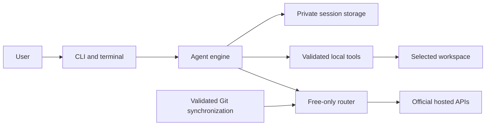

# Architecture

## System context

faac is a local terminal process. Hosted models propose text and tools; local code validates and executes tools under the user's permission policy. Provider-neutral sessions remain on disk between requests and restarts.

## Components

| Source                                     | Responsibility                                                                      |
| ------------------------------------------ | ----------------------------------------------------------------------------------- |
| `src/cli.ts`, `src/app.ts`                 | Process arguments, lifecycle, signals, current workspace, session coordination      |
| `src/terminal.ts`, `src/commands.ts`       | Input editor, rendering, prompts, slash commands                                    |
| `src/engine.ts`                            | Objective loop, context translation, compaction, fallback, tool sequencing          |
| `src/providers.ts`, `src/params.ts`        | Live discovery, HTTP/SSE execution, failure classification, capability validation   |
| `src/routing.ts`                           | Eligibility, shared quotas, scoped cooldowns, circuit recovery                      |
| `src/tools.ts`                             | Workspace boundaries, instruction discovery, reads, edits, shell, checkpoints, undo |
| `src/storage.ts`, `src/redactionStream.ts` | Private atomic state, credentials, locks, streaming redaction                       |
| `src/sync.ts`, `data/baseline.json`        | Read-only upstream extraction, supported transformations, quarantine, versions      |
| `src/types.ts`                             | Canonical data contracts                                                            |

## Request lifecycle

The application loads configuration and the selected session, acquires the workspace lock, reconciles interrupted actions, and initializes the upstream snapshot. The engine records a new request or continues the saved objective. It selects an eligible model, reconciles parameters and context, then streams the response. Only complete validated tool calls can execute. Each tool intent is saved before execution and its result afterward. A recoverable model failure records its scope and tries another eligible route with the existing session and current workspace state.

## State and security

State defaults to `~/.local/share/faac` and can be relocated with `FAAC_HOME`. Atomic private JSON writes and process locks protect local records. Credentials come from explicit environment variables or a passphrase-encrypted vault. Log and stream redaction complement, but do not replace, careful handling of sensitive files.

File edits require an expected hash. Missing or mismatched hashes prevent overwrites. Shell is unsandboxed and needs explicit approval or an exact command allowlist. Cancellation terminates the task rather than becoming a fallback error. Read [CLI contracts](API.md), [fallback design](../design/DESIGN.md), and [synchronization](SYNC.md) for details.

## Invariants

- Never send a paid or uncertain-price fallback request.
- Never execute incomplete streamed tool arguments.
- Persist intent before a side effect; do not replay uncertain shell outcomes blindly.
- Re-check file hashes before edits or undo.
- Scope model errors to the model and shared quotas to the actual pool.
- Hold one adapter snapshot for each active request; validate new snapshots before activation.
- Do not evaluate fetched TypeScript or run upstream repository scripts.

## Deployment and boundaries

Development and installed use run the same Node CLI. The container bundles the CLI, Git, and a writable state location; mount a chosen workspace explicitly. There is no HTTP server or database service to deploy. Public provider APIs and the configured Git remote require network access. Groq live inference and natural quota exhaustion remain separate verification work, recorded in the [roadmap](../planning/ROADMAP.md).

## Repository verification and publication

Development CI is PR-only: any source branch into develop, or a hotfix into main, runs source quality, package/container verification, and security jobs. Ordinary develop-to-main promotion uses a lightweight exact-tree evidence gate. Release dispatch reuses those prior results and performs artifact build/integrity work without repeating executable tests or scans. There is no delivery controller; task delegation and publication are explicit actions. See [GitFlow](../guides/GITFLOW.md).
