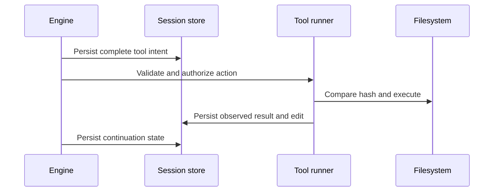

# Durable work and fallback

- Status: accepted and implemented
- Owner: Serhat Akbak
- Date: 2026-10-10
- Supersedes: none

## Problem and goals

An interrupted streamed response must not lose completed work or cause a shell action to run twice. Changing models must transfer the objective, instructions, tools, and actual workspace state. Concurrent user edits must remain intact.

## Design

The session is provider-neutral. It contains user instructions and messages, objective/progress, tool intents/results, completed edits with before/after hashes, checkpoints, interrupted response data, routing attempts, and compaction records. Writes occur throughout a request, not just after the final answer.

On failure, the router applies provider, account, or model scope. Shared quota pools are reserved centrally. Recoverable failures may move to another eligible model with bounded backoff. Invalid requests need diagnosis; cancellation stops. If every route is unavailable, the saved session remains resumable.

An interrupted file write can often be reconciled using hashes. An arbitrary shell command may have external effects that a local file check cannot establish. Such outcomes remain uncertain until inspected; automatic retry is refused. `/undo` applies only to recorded reversible edits whose current hashes still match.

## Trust boundaries

Model output, tool output, workspace instructions, and fetched upstream source are untrusted. Schema checks, permission prompts, workspace path rules, complete-call gating, and hash checks limit the effects they can request. Unsandboxed shell remains powerful and requires explicit authorization. Upstream code is parsed as data, never imported for execution.

## Alternatives and trade-offs

A transcript alone misses side effects and current workspace state. Treating a lost response as a safe retry risks duplication. Full context replay is impossible for smaller models; persisted compaction explicitly records the reduced context while retaining full local history. Hash checkpoints avoid bulky backups but do not restore arbitrary shell changes.

## Rollout and verification

The current implementation is exercised by deterministic fault injection and real temporary workspaces. Authenticated OpenRouter coding and restarted sessions were tested separately. The live alternate-model test injects a failure; it does not claim a natural quota event. See [verification](../reports/VERIFICATION.md).

## Remaining risks

External side effects cannot be guaranteed exactly once. Live provider capabilities and quota policies can change. Groq authenticated fallback remains unverified pending a confirmed Free-plan account. These limits are tracked in the [roadmap](../planning/ROADMAP.md); no unresolved architectural choice blocks the current official OpenRouter workflow.
